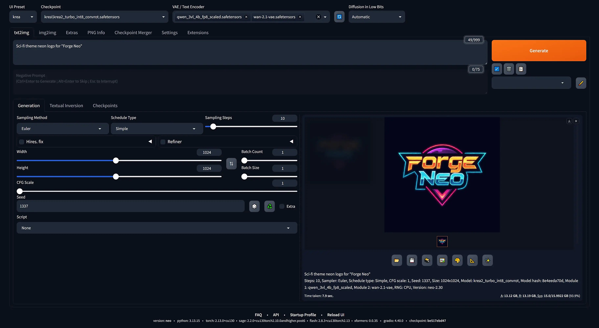

<div align="center">

# Forge Neo Remi

**一个以 Anima 为重点、开箱即用的 Stable Diffusion WebUI Forge Neo 发行分支。**

[English](README.md) | [简体中文](README.zh-CN.md)

[](LICENSE)
[](https://www.python.org/)
[](https://github.com/beautifulrem/sd-webui-forge-classic/tree/remi)
[](https://github.com/Haoming02/sd-webui-forge-classic/tree/neo)



</div>

Forge Neo Remi 是 [Forge Neo](https://github.com/Haoming02/sd-webui-forge-classic/tree/neo) 的下游发行分支，而 Forge Neo 建立在 [Stable Diffusion WebUI Forge](https://github.com/lllyasviel/stable-diffusion-webui-forge) 和 [AUTOMATIC1111 WebUI](https://github.com/AUTOMATIC1111/stable-diffusion-webui) 之上。Remi 保留熟悉的 WebUI 工作流，同时集成经筛选的 Anima 生成技术、Neo 兼容内置扩展、冲突感知控件和保守的上游修复。

> [!IMPORTANT]
> 这是独立的下游分支，不是 Forge Neo 或 Anima 模型的官方发行版。Remi 优先保证集成工作流的可用性和可验证性，不承诺兼容所有第三方扩展。

## 为什么选择 Remi？

- **Anima 优先推理：** 内置采样器、引导方法、空间控制、LoRA 管理、高分辨率保护和加速路径。
- **28/40/52 层架构兼容：** 自动识别原始 Anima、2.9B 和 3.8B 的 DiT 结构；28 层 LoRA 和 Anima ControlLLLite 模型会重映射到扩展模型上，分层权重、阶段调度器的 block 权重和 FreeFuse 的采集层在扩展模型上仍按 28 层布局解释。3.8B 还需要外部条件编码扩展（见[支持的模型家族](#支持的模型家族)）。
- **GUI 与运行时冲突管理：** 互斥功能会在组成未定义采样链之前被锁定或自动解决。
- **一键安全基线：** **Anima Remi Presets** 提供保守的推荐起点，不会覆盖提示词、LoRA 名称或模型路径。
- **常用功能内置：** 常用的 Neo 适配扩展随 Remi 一起版本化。
- **选择性同步上游：** 吸收有价值的修复，同时保留 Remi 的 Anima attention hook、生命周期清理和采样器保护。

## Anima 集成

| 领域 | 内置能力 |
| --- | --- |
| 采样 | Beta57、Flow Euler、UniPC2、PC3、SPEED（实验：前段半分辨率；切换 sigma 可在设置中调整）、ER SDE、Dynamic Shift |
| 引导 | NAG、Momentum Guidance、Skimmed CFG、SMC、CFG-Zero*、APG、TCFG、FDG、DCW、CNS、CFG 生效区间（只在模型时间窗口内执行 CFG：起止值是模型去噪时间的比例，经 `percent_to_sigma` 换算为 sigma，不是步数比例；窗口外若无其他 hook 读取，则跳过负向推理）、CLIP Modulation guidance（默认首次使用时下载固定版本的 adapter 与 CLIP-L，也可使用本地文件） |
| 空间控制 | Regional Conditioning、FreeFuse 多 LoRA 路由、Artist Scheduled Mixer |
| 多样性 | DAVE（前段 DC 衰减，提升同一提示词不同 seed 的构图多样性） |
| 提示词遵循 | Cross-Attention Boost（高噪声前段放大正向提示词的 cross-attention 并做范数匹配，改善弱标签与多主体绑定） |
| LoRA 工作流 | 分层权重、阶段调度、2B LoRA 用于 2.9B/3.8B（28/40/52 层）、提示词缩放 |
| 稳定性 | 功能冲突解析、Hires Guard、生成元数据、安全回退 |
| 加速 | Spectrum 预测，以及 Anima per-block `torch.compile`（首次重新编译后，改变的分辨率或 batch size 复用同一个动态形状图；batch 1（CFG 1，或 CFG 区间外的步）和参考帧仍各自编译独立的图） |
| 低比特加载 | **Diffusion in Low Bits** 中的 `float8-e4m3fn (Anima scaled)`（按张量缩放的 FP8，显存与普通 FP8 相同、精度更高）和 `int8 (Anima ConvRot)`（INT8 矩阵乘；需要 CUDA 13 或 `--enable-triton-backend`，SM 8.0+） |

组合实验性方法前，请先阅读 [Remi Anima 生成与参数指南](docs/remi-anima-generation-guide.zh-CN.md)。

## 支持的模型家族

Remi 保留 Forge Neo 对现代模型的支持重点，并对 Anima 提供更深入的集成。

- Anima 和 Anima Edit：2B（28 层）、2.9B（40 层）与 3.8B（52 层）checkpoint

> [!NOTE]
> Remi 只覆盖 3.8B 的**扩散模型**部分（52 层 DiT 结构与 LoRA 映射）。Anima 3.8B 以 Qwen3.5 4B 为条件：v1.1 checkpoint 内置一个随时间步变化、每个去噪步都参与计算的 Semantic Connector（v2），并需要在原生 Qwen3 0.6B 之外另备 `qwen35_4b` 文本编码器。Remi 没有 Qwen3.5 条件编码或 connector 代码；与上游 Forge Neo 相同，这条路径需要 [forge-anima-3.8B](https://github.com/GumGum10/forge-anima-3.8B) 扩展，Remi 未内置也未测试它。详见 [Anima 3.8B 模型卡](https://huggingface.co/lylogummy/Anima-3.8B)。
- SD 1.x 和高级 SDXL 变体
- Krea 2 和 Krea 2 Identity Edit
- FLUX Kontext 和 FLUX.2 Klein
- Qwen-Image、Qwen-Image-Edit 和 Qwen-Image-2.1
- Ernie-Image、PiD 1.5、Z-Image、Mugen、Lumina Image 2 和 Chroma
- Wan 2.2 图像/视频工作流

请参考上游的 [模型下载指南](https://github.com/Haoming02/sd-webui-forge-classic/wiki/Download-Models) 放置 checkpoint、VAE 和文本编码器。

## 快速开始

### 环境要求

- [Git](https://git-scm.com/downloads)
- [Python 3.13](https://www.python.org/downloads/) 或 [uv](https://docs.astral.sh/uv/)
- PyTorch 支持的计算设备；NVIDIA GPU 是目前测试最充分的选项
- 可选：导出视频时需要 [FFmpeg](https://ffmpeg.org/)

### 克隆 Remi 分支

```bash
git clone --branch remi https://github.com/beautifulrem/sd-webui-forge-classic.git forge-neo-remi
cd forge-neo-remi
```

### Windows

运行：

```bat
webui-user.bat
```

如果使用推荐的 `uv` 方式，先创建虚拟环境，然后在 `webui-user.bat` 的 `COMMANDLINE_ARGS` 中加入 `--uv`：

```bat
uv venv venv --python 3.13 --seed
```

### Linux 和 macOS

运行：

```bash
./webui.sh
```

首次安装会优先使用 `python3.13`；若未找到，则通过 `uv` 查找或安装 Python 3.13 并创建虚拟环境。已有虚拟环境会继续使用，不会自动删除或重建。macOS 默认从 PyPI 安装原生 `torch` 和 `torchvision`，不使用 CUDA wheel。

自定义配置请写入仓库根目录的 `webui.settings.sh`（不会提交到 Git），例如：

```bash
export PYTHON="/path/to/python3.13"
export COMMANDLINE_ARGS="--uv"
# 可选：覆盖自动选择的 PyTorch 安装命令
# export TORCH_COMMAND="pip install torch torchvision"
```

平台依赖与启动配置请参考上游 [Unix 安装指南](https://github.com/Haoming02/sd-webui-forge-classic/wiki/Unix)。Apple Silicon 可使用 PyTorch MPS，但无法使用仅支持 CUDA 的 attention 和编译后端，生成速度通常慢于独立 GPU。

首次启动会自动安装 Python 依赖。将 checkpoint 及配套模块放入对应的 `models/` 子目录，然后重启 WebUI 或刷新模型列表。

## 首次 Anima 生成建议

1. 加载支持的 Anima checkpoint 及所需文本编码器/VAE。
2. 打开 **Anima Remi Presets**。
3. 应用 **Official Base/Aesthetic — Safe (Recommended)**。
4. 先关闭可选引导、空间控制、Hires 和编译功能生成一次。
5. 每次只增加一个高级功能，并用相同种子对比。

安全预设以 `ER SDE`、`36` 步、`CFG 4.5` 和模型标准 shift 行为为起点。它会为尚未启用的模块写入可复现默认值，但不会暗中启用实验性功能链。

Anima-Turbo checkpoint 请选择 **Official Turbo**（`Euler`、`10` 步、`CFG 1`），或选择 **Turbo + NAG**，通过 Normalized Attention Guidance 在 CFG 1 下保留负面提示词，且不需要额外的无条件前向。Turbo checkpoint 使用 Base 参数（或反过来）时会在日志中给出提醒。

## 内置扩展

Remi 随分支提供经筛选的内置扩展，包括：

- ADetailer Neo、Agent Scheduler Neo、Repeat Generate 4NEO、NegPiP 和 Detail Daemon
- Prompt All-in-One Neo、TagComplete Neo、提示词队列/工作台辅助和本地化支持
- Forge ControlNet、预处理器、IP-Adapter、MultiDiffusion、Image Stitch 和后处理工具
- Remi 的 Anima Guidance、Regional、FreeFuse、Artist Mixer、LoRA 调度、Hires Guard、Spectrum、PiD 和编译集成

“内置”表示这些扩展随 Remi 分支一起版本化，并参与兼容性检查；不代表所有外部扩展都与 Remi 兼容。

## 常用启动参数

| 参数 | 作用 |
| --- | --- |
| `--uv` | 使用 `uv pip` 安装依赖 |
| `--model-ref PATH` | 用集中模型目录替换本地 `models` 目录 |
| `--forge-ref-a1111-home PATH` | 复用 AUTOMATIC1111 安装中的模型目录 |
| `--forge-ref-comfy-home PATH` | 复用 ComfyUI 安装中的模型目录 |
| `--forge-ref-comfy-yaml PATH` | 读取 ComfyUI `extra_model_paths.yaml` |
| `--sage` / `--flash` | 安装可选 attention 包；安装成功不代表一定被选中 |
| `--agent-scheduler-trust-unsigned-params` | 升级后使用一次：为旧版本保存的 Agent Scheduler 任务签名（见下文） |

不要盲目安装所有 attention 后端。PyTorch 原生 attention 通常是兼容性最好的选择。更多参数可运行 `python launch.py --help`，并参考上游 [额外安装指南](https://github.com/Haoming02/sd-webui-forge-classic/wiki/Extra-Installations)。

## 安全与远程访问

Remi 加固了内置扩展添加到 WebUI 服务器上的接口。使用 `--share`、`--listen` 或反向代理时尤其重要：

- **拒绝跨站写请求。** 所有扩展新增的接口都会拒绝来自其他站点的浏览器写请求（依据 `Origin` / `Sec-Fetch-Site`）。脚本和 API 工具不带 `Origin` 头，不受影响。其他来源的浏览器前端需要通过 `--cors-allow-origins` / `--cors-allow-origins-regex` 放行。
- **拒绝 DNS 重绑定。** 未使用 `--listen`、非回环地址的 `--server-name`、`--share` 或 `--ngrok` 时服务只监听本机回环地址，扩展接口只接受 `localhost` / 回环地址（或 `--cors-allow-origins` 放行的主机名）作为 `Host`。本机反向代理需要转发其中之一作为 `Host`，或用 `--cors-allow-origins` 放行其公网来源。
- **Gradio 登录覆盖扩展接口。** 设置 `--gradio-auth` 后，Agent Scheduler、Prompt All-in-One（提示词历史、保存的 API 密钥）、TagComplete 和 Prompt Queue 的接口需要与界面相同的登录。设置 `--api-auth` 时，Agent Scheduler 仍使用 HTTP Basic 认证。
- **对外暴露时所有扩展接口都要登录。** 使用 `--share`、`--ngrok`、`--listen` 或非回环地址的 `--server-name`，并设置 `--gradio-auth` / `--gradio-auth-path` 时，其他扩展新增的接口同样需要界面登录。脚本和 API 工具（包括局域网内的）此时用 `--api-auth` 的 HTTP Basic 凭据认证（与 `/sdapi` 相同）；未设置 `--api-auth` 时会被拒绝。使用 `--nowebui`（仅 API）时没有界面登录：只要设置了 `--api-auth`，无论监听哪个地址（包括回环地址），这些接口都需要其凭据，与 `/sdapi` 完全相同。只监听回环地址的界面服务对 API 工具保持开放。
- **反向代理**需要转发公网主机名。如果代理在 `Host` 中去掉了非默认的公网端口（例如 nginx 在 `:8443` 上使用 `$host`），请同时发送 `X-Forwarded-Port`，否则界面上的保存操作会被当作跨站请求拒绝。
- **Agent Scheduler 任务参数经过签名。** 队列任务以 pickle 保存脚本参数，因此会用本安装专属的密钥签名（`agent_scheduler_signing.key`，位于任务数据库旁）。迁移安装目录或 Docker 数据卷时，请把该文件和数据库一起带走。`/import` 只接受本安装导出的队列。任务数据库和密钥不会通过 `/file=` 对外提供。
- **对外请求**（API 回调、图片 URL）按实际连接到的地址检查：拒绝云元数据和链路本地地址；图片 URL 遵循 Forge *设置 → API* 中的请求策略。

### 从旧版 Remi 或 Agent Scheduler 升级

签名机制出现之前保存的任务不会运行，并会提示原因。如果没有其他人能向你的数据库导入任务，请带上 `--agent-scheduler-trust-unsigned-params` 启动一次，然后去掉该参数；因未签名而失败的任务可在 History 页重新排队。

## 文档

- [Remi Anima 生成与参数指南](docs/remi-anima-generation-guide.zh-CN.md)
- [Anima 生成优化技术研究](docs/research/anima-generation-optimizations.md)
- [Remi 架构说明](docs/remi-architecture-notes.md)：功能接入点与有意保留的取舍
- [Forge Neo Wiki](https://github.com/Haoming02/sd-webui-forge-classic/wiki)
- [模型下载](https://github.com/Haoming02/sd-webui-forge-classic/wiki/Download-Models)
- [推理参考](https://github.com/Haoming02/sd-webui-forge-classic/wiki/Inference-References)

## 兼容性说明

- Forge Neo 已移除的训练功能、旧模型家族和部分旧 WebUI 组件不会由 Remi 恢复。
- 第三方扩展可能依赖 Neo 或 Remi 已主动修改的 API。
- FlashAttention 等仅支持 CUDA 的依赖无法在所有平台上使用。
- 实验性引导方法不仅可能改变质量，也可能改变画面特征；对比时请保留固定种子的基线结果。
- 开启 NAG、NegPiP、Regional、FreeFuse、Artist Mixer、DAVE 或 Cross-Attention Boost（其窗口内的步骤）或 Sparse Attention 时，Torch compile（整模型预设和 **Anima per-block**）会让相关步骤以未编译方式运行，确保这些功能不会被缓存的编译图悄悄忽略；这类生成不会获得编译加速。
- **Anima FlowMatch** 只适用于 flow-matching 模型；用在其他模型上（例如从 Anima Flow 采样器切换后仍保留该调度器）会回退到 Simple 调度。
- 真实 checkpoint 生成是最终兼容性测试。成功启动或单元测试通过，不能证明所有 checkpoint 和量化都具有相同生成质量。

## 问题反馈与贡献

提交问题前，请先在最新 `remi` 分支上关闭外部第三方扩展并复现。反馈中请包含：

- Remi commit hash
- 操作系统、GPU/后端、Python 和 PyTorch 版本
- checkpoint 家族与量化格式
- 启动参数和相关生成参数
- 完整控制台 traceback 或最小复现步骤

Remi 特有问题请使用 [Remi issue tracker](https://github.com/beautifulrem/sd-webui-forge-classic/issues)。只存在于上游的问题，应先在 [Forge Neo](https://github.com/Haoming02/sd-webui-forge-classic/tree/neo) 上复现，再向上游提交。

贡献应尽量保持功能隔离，不破坏非 Anima 模型行为，为共享采样/模型加载路径增加回归测试，并说明 GUI 与运行时冲突语义。

## 上游与致谢

Remi 基于 [AUTOMATIC1111](https://github.com/AUTOMATIC1111/stable-diffusion-webui)、[lllyasviel](https://github.com/lllyasviel/stable-diffusion-webui-forge)、[Haoming02](https://github.com/Haoming02/sd-webui-forge-classic)、[ComfyUI](https://github.com/Comfy-Org/ComfyUI) 以及所有内置扩展/算法作者的工作构建。各组件保留其原始许可证和声明。

## 许可证

主项目采用 [GNU Affero General Public License v3.0](LICENSE)。内置扩展和引入的组件可能附带其他兼容许可证，请查看对应目录中的 `LICENSE` 文件。
